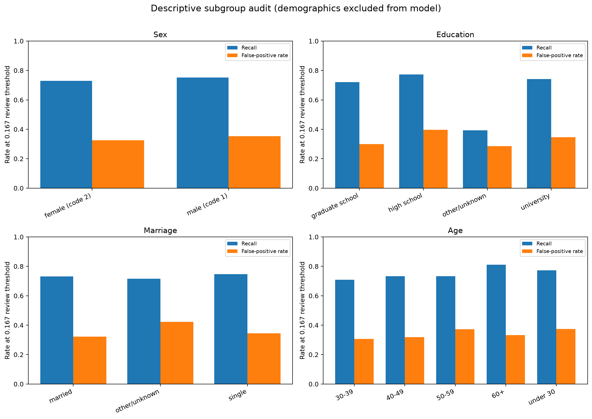
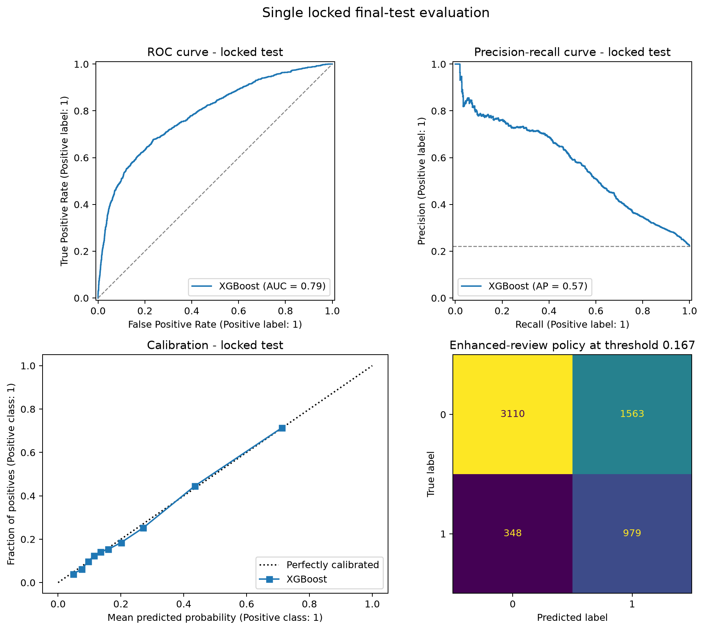

# Credit Default Risk Modeling and Validation

An end-to-end credit-risk project comparing an interpretable logistic-regression baseline with a gradient-boosting challenger. The emphasis is not only predictive performance, but also leakage prevention, probability calibration, stability monitoring, and defensible model validation.

## Current status

**Milestone 4 — governed final validation:** complete

- [x] Reproducible download from the official UCI repository
- [x] Data-contract and leakage audit
- [x] Locked, stratified development/test split
- [x] Exploratory analysis and responsible feature policy
- [x] Logistic-regression baseline
- [x] Gradient-boosting challenger
- [x] Calibration and cost-sensitive thresholding
- [x] PSI and drift stress tests
- [x] Final model card and recruiter-ready summary

## Business question

Can we estimate the probability that a credit-card client will default next month, while producing probabilities that are useful for risk decisions rather than only optimizing classification accuracy?

## Data

The project uses the **Default of Credit Card Clients** dataset from the UCI Machine Learning Repository. It contains 30,000 client records, 23 explanatory variables, and a binary next-month default outcome. The source workbook is downloaded by script and is not committed to GitHub.

- Source: [UCI Machine Learning Repository](https://archive.ics.uci.edu/dataset/350/default+of+credit+card+clients)
- DOI: [10.24432/C55S3H](https://doi.org/10.24432/C55S3H)
- License: CC BY 4.0

## Validation design

The source data includes six months of repayment history but **does not include a borrower observation date suitable for a true out-of-time split**. This project therefore does not label any split as out-of-time.

Instead, it uses:

1. a fixed, stratified development/test split;
2. cross-validation only inside the development sample;
3. a final test set that remains locked until model and threshold choices are complete;
4. calibration diagnostics and Brier score;
5. PSI and synthetic/segment drift stress tests, clearly labeled as stability analyses rather than temporal validation.

## Planned model comparison

| Model | Role | Main evaluation focus |
|---|---|---|
| Logistic regression | Interpretable baseline | coefficients, discrimination, calibration |
| Gradient boosting | Nonlinear challenger | incremental lift, calibration, stability |

Primary metrics will include ROC-AUC, PR-AUC, Brier score, precision, recall, and expected decision cost at a selected threshold.

## Baseline result

The first model is an unweighted, L2-regularized logistic regression. Numerical variables are standardized. `SEX`, `EDUCATION`, `MARRIAGE`, and `AGE` are excluded from both predictive models and retained only for subgroup auditing; model inputs are limited to credit limit and prior repayment, bill, and payment behavior.

The values below are **out-of-fold predictions from five-fold stratified cross-validation on the 24,000-row development sample**. The 6,000-row final test sample has not been accessed.

| Metric | Development OOF result |
|---|---:|
| ROC-AUC | 0.721 |
| PR-AUC / Average precision | 0.504 |
| Brier score | 0.145 |
| Log loss | 0.467 |
| 10-bin expected calibration error | 0.046 |


The baseline provides meaningful risk ranking, but the calibration plot shows room for improvement.

## Fair challenger comparison

The XGBoost challenger uses the same 24,000 development rows, target, feature policy, five stratified folds, random seed, and evaluation metrics as the logistic baseline. Numeric scaling is omitted for XGBoost because tree splits are scale invariant; all other data boundaries remain identical. Hyperparameters were specified before the comparison, and neither model accessed the locked final test set.

| Model | ROC-AUC | PR-AUC | Brier score | Log loss | ECE (10 bins) |
|---|---:|---:|---:|---:|---:|
| Logistic regression | 0.721 | 0.504 | 0.145 | 0.467 | 0.046 |
| XGBoost | **0.779** | **0.550** | **0.135** | **0.430** | **0.007** |


A 500-repetition paired bootstrap on the same out-of-fold rows estimated:

- ROC-AUC gain: 0.058 (95% interval: 0.052 to 0.065)
- PR-AUC gain: 0.046 (95% interval: 0.038 to 0.054)
- Brier-score reduction: 0.010 (95% interval: 0.009 to 0.011)

These results support XGBoost as the current challenger winner on development data. They do not yet constitute final generalization evidence; stability tests and one final locked-test evaluation remain.

## Calibration decision and cost-sensitive policy

Calibration was evaluated with a second layer of five-fold cross-fitting on the development OOF scores. This prevents a calibration map from being fitted and assessed on the same observations.

| Calibration method | Brier score | Log loss | ECE (10 bins) |
|---|---:|---:|---:|
| Raw XGBoost | **0.135048** | **0.430492** | 0.007161 |
| Platt scaling | 0.135057 | 0.430506 | 0.006702 |
| Isotonic regression | 0.135238 | 0.435159 | **0.003965** |

The pre-specified selection rule prioritizes Brier score, with log loss as a tie-breaker. The raw XGBoost probabilities are therefore retained: adding a calibrator would marginally worsen overall probability accuracy.


Decision thresholds are framed as **enhanced-review policies**, not automatic credit denials. Because the dataset contains no real bank cost ledger, the analysis reports transparent hypothetical scenarios with false-positive cost normalized to one:

| Assumed false-negative cost | Theoretical threshold | Flag rate | Precision | Recall | Specificity |
|---:|---:|---:|---:|---:|---:|
| 2x false positive | 0.333 | 18.9% | 57.8% | 49.5% | 89.8% |
| 5x false positive | 0.167 | 42.5% | 38.5% | 73.9% | 66.4% |
| 10x false positive | 0.091 | 76.1% | 27.1% | 93.2% | 28.7% |

The 5x scenario is the primary illustration, not a claim about an actual institution's economics. Its threshold follows directly from calibrated probability decision theory: `1 / (1 + 5) = 0.167`. The policy remains frozen before the final test is accessed.

## PSI stability stress tests

Because the dataset has no account-level observation date, this project does not fabricate temporal monitoring data. Instead, the fitted development model is subjected to transparent synthetic stresses, while a random-half control checks the PSI implementation against ordinary sampling variation.

| Scenario | Mean risk: reference | Mean risk: comparison | PSI | Descriptive band |
|---|---:|---:|---:|---|
| Same-distribution random-half control | 0.223 | 0.220 | 0.001 | Low shift |
| Payment amounts reduced by 30% | 0.221 | 0.232 | 0.026 | Low shift |
| Non-negative repayment-delay codes increased by one | 0.221 | 0.301 | 0.535 | High shift |
| Combined delay and payment stress | 0.221 | 0.314 | 0.690 | High shift |


The 0.10 and 0.25 PSI bands are descriptive monitoring heuristics, not regulatory pass/fail rules. The results show that the model's score distribution is relatively insensitive to a payment-amount reduction alone but highly sensitive to broad deterioration in repayment status. These scenarios are robustness probes, not claims about future portfolio performance.

## Descriptive subgroup audit

Demographic variables are not model inputs. They are used after scoring to inspect whether the frozen 0.167 enhanced-review threshold behaves differently across recorded sex, education, marital-status, and age groups.



The two recorded sex groups have recall of 75.2% and 72.9%, with false-positive rates of 35.2% and 32.5%. Larger education, marital-status, and age groups show broadly similar recall, but the 379-row education other/unknown group is notably unstable. The audit is descriptive, sample-dependent, and not a legal or causal fairness certification.

## Single locked final-test evaluation

All model, feature, calibration, and threshold decisions were frozen and committed before the 6,000-row test sample was accessed. The evaluation script records the pre-test commit and refuses to run again after the result artifact exists.

| Metric | Locked-test result | 95% bootstrap interval |
|---|---:|---:|
| ROC-AUC | **0.787** | 0.772 to 0.802 |
| PR-AUC / Average precision | **0.571** | 0.542 to 0.598 |
| Brier score | **0.132** | 0.126 to 0.137 |
| Log loss | **0.422** | 0.408 to 0.436 |

At the frozen 0.167 enhanced-review threshold, the final test produced:

- recall: 73.8%;
- precision: 38.5%;
- specificity: 66.6%;
- review flag rate: 42.4%;
- 979 true positives, 1,563 false positives, 3,110 true negatives, and 348 false negatives.

The development-to-test score PSI is 0.0029, indicating very little score-distribution shift between the fixed samples. No model or policy decision was changed after observing the test.



See the [model card](docs/model_card.md) for intended use, governance, limitations, and responsible-use boundaries.

## Repository structure

```text
credit-risk-model-validation/
├── data/
│   ├── raw/                 # downloaded locally; never committed
│   ├── interim/             # local intermediate data
│   └── processed/           # reproducible split IDs and safe outputs
├── docs/                    # data and validation documentation
├── models/                  # local serialized models
├── notebooks/               # analysis notebooks
├── reports/
│   ├── figures/
│   └── tables/
├── scripts/                 # executable project steps
├── src/credit_risk/         # reusable project code
└── tests/                   # automated data-contract tests
```

## Quick start

```bash
python3.12 -m venv .venv
source .venv/bin/activate
python -m pip install -r requirements.txt
python scripts/download_data.py
python scripts/run_data_audit.py
python scripts/train_logistic_baseline.py
python scripts/train_xgboost_challenger.py
python scripts/calibrate_and_select_threshold.py
python scripts/run_stability_stress_test.py
python scripts/run_subgroup_audit.py
pytest
```

`scripts/evaluate_locked_test_once.py` is intentionally omitted from the normal rerun sequence: the governed final evaluation has already occurred and the script will reject another run while its result artifact exists.

## Responsible-use note

This is an educational model-validation project, not a production lending system. Demographic fields require careful policy, fairness, and legal review. They will be used for audit and subgroup diagnostics; their inclusion in any candidate model will be explicitly justified rather than assumed.
